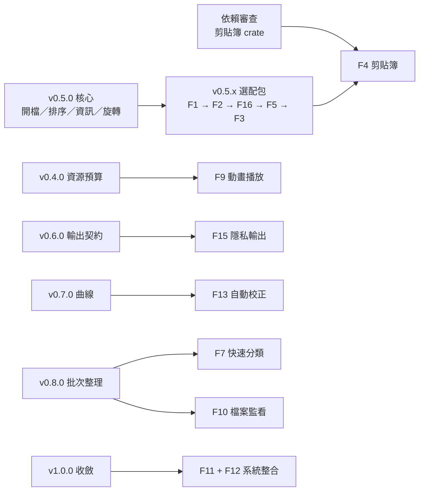
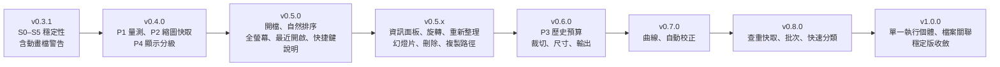

# 後續功能與改版路線圖

日期：2026-10-22。狀態：規劃提案，尚未授權實作；版本編號為建議交付順序，不是已承諾的發布日期。同日經使用者訪談修訂優先順序，決策見 [第 11 節](#11-使用者訪談決策紀錄2026-10-22)。

本文件延伸 [現行規格](SPEC_RUST_IMAGE_VIEWER.md)，執行計畫與勾選進度仍以 [plan.md](../tasks/plan.md) 及 [todo.md](../tasks/todo.md) 為準。此次只新增規劃，不變更產品程式、既有標籤或發布狀態。

## 1. 方向與目前基線

維持 Windows 優先、純 Rust 單一執行檔、背景影像運算、記憶體 Undo/Redo、原子輸出及壓縮檔唯讀。先補齊穩定性與資源上限，再逐步擴充日常操作、編輯與批次整理。

- 已有：背景開檔／儲存、離開保護、雙圖比較、微調、直方圖、放大鏡、縮圖列、查重、壓縮檔與偏好設定。這些屬於改善基礎，不重新列為待開發的新功能。
- v0.3.0 已提交並標記，81 項本機測試、Clippy、發布建置與第三批使用者桌面驗收完成。執行檔 6,651,392 位元組；本次規劃查詢時，對應 [標籤 CI](https://github.com/kkdisk/image-viewer-rust/actions/runs/39760086200) 及 [main CI](https://github.com/kkdisk/image-viewer-rust/actions/runs/39760086220) 仍在執行，草稿完成尚無證據。
- 第一、二批桌面驗收項目，使用者於 2026-10-22 回報已手動驗證通過，不阻擋後續開發與發布。
- 暫不承諾跨平台發布、RAW／HDR／16 位元編輯、AI 修圖、雲端同步或影片功能。影片原本即不在移植意圖範圍。

## 2. 來源核對與優先順序依據

以下為原始碼靜態核對結果，尚未新增重現測試或效能量測；列入下一批驗證，不回寫既有驗收結果。

| 核對項目 | 目前來源與觀察 | 規劃影響 |
|---|---|---|
| 底圖儲存狀態 | [Session](../crates/viewer-state/src/session.rs) 的 `is_dirty()` 包含預覽；[狀態列](../crates/app-ui/src/panels/status_bar.rs) 又用它決定 `committed_dirty` | 補上「已儲存底圖完成預覽運算後仍顯示已儲存」回歸，拆清底圖與預覽語意 |
| 查重預覽安全與回應 | [查重面板](../crates/app-ui/src/panels/duplicate_dialog.rs) 的 `get_or_load_preview()` 直接 `image::open()`、縮圖；完成交付時也讀取每張圖的檔案大小與尺寸 | 統一安全解碼、移至背景，加入請求編號與失敗回饋 |
| GPU 單邊限制 | [主圖紋理更新](../crates/app-ui/src/app.rs) 直接以完整尺寸建立紋理；[載入器](../crates/core-image/src/io.rs) 的 64M 限制是總像素數 | 先補實際 GPU 上限保護；低於總像素上限的長條圖仍須安全顯示 |
| 縮圖與快取 | [縮圖管理器](../crates/app-ui/src/thumbnail_loader.rs) 使用 HashMap、待處理數量限制及清空；未見總位元組預算與資料夾世代檢查 | 改以資源預算管理快取，隔離切換目錄及檔案更新前的舊結果 |
| 歷史記憶體 | [歷史管理器](../crates/viewer-state/src/history.rs) 以快照保留最多 20 步，未見位元組預算 | 大圖與更多編輯能力前，先增加可量測的記憶體治理 |
| 基本幾何編輯 | [EXIF 模組](../crates/core-image/src/exif.rs) 已能校正方向，Session 有 `push_action()`；目前未見完整的手動旋轉／翻轉 UI 契約 | 能重用底層能力，但須先處理未套用預覽，不能直接呼叫會取消預覽的 helper |
| 瀏覽與輸出 | [清單](../crates/app-ui/src/playlist.rs) 主要按名稱排序；[進入點](../crates/app-ui/src/main.rs) 未見圖片參數開檔；[寫檔](../crates/core-image/src/io.rs) 主要依副檔名選編碼 | 分版補排序、命令列開檔、資訊面板及明確輸出選項 |

資源規模提醒：64×1024×1024 個 RGBA8 像素每份約 256 MiB；20 份不同完整快照約 5 GiB，尚未包含額外預覽與紋理。這是理論容量計算，不是已量測的程序用量，因此「20 步」不能當成低記憶體保證。

## 3. 建議版本順序

| 版本／優先度 | 使用者可感知的成果 | 主要範圍 | 發布門檻 |
|---|---|---|---|
| v0.3.1／最高 | 預覽狀態正確，查重與特殊長條圖更穩定，動畫檔不會被悄悄存成靜態圖 | 底圖／預覽語意、查重安全背景讀取、GPU 單邊上限保護、動畫檔標示與儲存警告 | S1–S5 完成；補齊相關桌面案例；v0.3.0 發布結果已核對 |
| v0.4.0／高 | 大圖與長時間瀏覽的資源使用可控制 | 量測基線、縮圖快取預算、顯示預覽分級（歷史快照預算移至 v0.6.0 前） | 顯示不超 GPU 上限；反覆切圖不持續累積快取；輸出保留完整解析度 |
| v0.5.0／高 | 日常看圖體驗完整 | 命令列／資料夾開啟、自然排序與排序選項、全螢幕、最近開啟、快捷鍵說明 | 排序保持選取；開檔共用離開保護；全螢幕進出還原版面；多視窗不互相破壞設定 |
| v0.5.x／中高 | 看圖時的便利操作 | 唯讀資訊面板、90 度旋轉與翻轉、幻燈片、刪除至回收桶、重新整理、複製路徑 | 每項獨立驗收；旋轉可復原；刪除失敗不動原檔 |
| v0.6.0／中高 | 可精準裁切、改尺寸並選擇輸出格式 | 前置 P3 歷史快照預算；比例裁切、數值尺寸、重採樣、輸出格式與透明度選項 | 預覽／取消／套用一致；輸出尺寸正確；失敗不改壞原檔 |
| v0.7.0／中 | 更細緻且可重用的調色 | RGB／通道曲線、參數預設集、重設與原圖比較 | 恆等曲線不變色；快速拖曳只採最新結果；預設集可版本化讀寫 |
| v0.8.0／中 | 大量相片整理與批次輸出 | 查重快取與規則、批次改尺寸／格式、逐檔進度與錯誤摘要 | 不永久刪除；可停止排程；單檔失敗不破壞其他輸出 |
| v1.0.0／收斂 | 有明確支援範圍、可重現驗證的 Windows 穩定版 | 相容性矩陣、完整桌面回歸、效能基線、發布說明 | 正式範圍凍結；CI、乾淨 Windows 驗證與資源門檻通過 |

使用者以「快速看圖、偶爾微調」為主，因此 v0.5.0 優先放每天都會用到的瀏覽功能，旋轉、資訊面板等改列 v0.5.x 小版本。中期維持 v0.6.0 → v0.7.0 → v0.8.0，因為批次輸出依賴 v0.6.0 的輸出契約。

修正既有行為用 PATCH，新增已驗證功能用 MINOR；1.0.0 表示穩定契約與驗收收斂。未發布版本的範圍可調整，已發布標籤不移動。

## 4. 能力責任與相依關係

此為責任分配提案，不增加 crate，也不直接變更現有公開 API。較大的能力在開發前補各自規格與介面契約。

| 現有模組 | 後續責任 | 相依與邊界 |
|---|---|---|
| core-image | 安全解碼、顯示用下採樣、幾何操作、曲線與編碼選項 | 不依賴 UI；顯示預覽不能取代輸出原始像素 |
| viewer-state | 編輯提交、預覽、歷史與記憶體預算 | 保存底圖／預覽的分離；背景結果核對文件及來源版本 |
| app-ui | 請求排程、GPU 紋理、瀏覽操作、資訊與批次介面 | UI 不做阻塞性解碼或批次磁碟工作 |
| duplicate-finder | 雜湊、分群、可重用的查重結果 | 雜湊規格與門檻需可辨識；檔案更新使快取失效 |
| core-archive | 壓縮檔受管理生命週期與安全讀取 | 批次工作持有 Session；壓縮檔來源仍只能另存外部 |

相依順序：安全讀取與狀態語意 → GPU／記憶體治理 → 幾何編輯與輸出契約 → 裁切／曲線 → 批次重用。批次輸出至少依賴 v0.6.0 的輸出契約，不必等待所有調色選配。

## 5. 下一批：v0.3.1 修補切片

建議稱為「第4批穩定性補強」。以下屬待審閱任務，不因寫入待辦而自動開始實作。

### S0：發布基線與驗收收尾（M）

- 核對 v0.3.0 標籤工作、產物、版本與草稿結果；第一、二批桌面案例依使用者回報記錄為通過，保留各批驗收來源與第三批的區別。
- 明確記錄驗證工具鏈及最低 Rust 版本的檢查狀態；目前 1.99.1 驗證不能代替規格最低版本的相容性證據。規格與封裝腳本的體積單位也需統一。
- 預計檔案：`docs/WINDOWS_BUILD.md`、`tasks/plan.md`、`tasks/todo.md`；如需調整工具鏈或 CI，另列小切片。驗證：對應遠端工作與人工桌面紀錄，不用重跑無變更的測試代替。

### S1：底圖與預覽狀態分離（M，依賴 S0）

- 已儲存圖片完成預覽運算後，顯示「預覽未套用／底圖已儲存」；已套用未存檔底圖再預覽時，顯示「底圖未儲存」。
- 取消、套用、Undo／Redo 與儲存均有狀態回歸；不得因此移除現有離開保護。
- 預計檔案：Session、狀態列與對應測試，約 3–4 檔。驗證：`cargo +1.99.1 test -p viewer-state -p app-ui --locked --offline`，另做桌面切換確認。

### S2：查重預覽安全背景化（M，依賴 S0）

- 查重預覽共用安全像素限制，解碼及縮圖在背景完成；主畫面只交付目前仍有效的請求與紋理。
- 損毀、超限、快速切換比較圖與關閉查重視窗都有結果，不把舊圖交付到新選取項目；已執行中的解碼不宣稱可以強制中止。
- 預計檔案：查重面板、新增背景預覽模組與測試，約 3–5 檔。驗證：`cargo +1.99.1 test -p core-image -p app-ui --locked --offline`，以慢速／大圖人工確認介面回應。

檢查點 A：S1、S2 的新增回歸及既有測試通過；人工確認預覽狀態、查重切圖與失敗回饋後，再接下一組。

### S3：查重結果的背景資料交付（M，依賴 S2）

- 檔案大小與尺寸在背景階段產生，不在結果接收的 UI 迴圈逐檔讀取。
- 結果明確包含成功與略過／失敗數；未知尺寸仍不能自動勾選刪除。舊掃描不得覆蓋新掃描。
- 預計檔案：查重排程／面板與測試，約 3–4 檔。驗證：`cargo +1.99.1 test -p app-ui --locked --offline`，以含損毀圖與大目錄的測資確認完成時不卡住。

### S4：GPU 單邊上限保護（M，依賴 S2 的背景交付模式）

- 主圖、原圖與參考圖均依實際圖形裝置上限建立顯示預覽；低於總像素限制的超長邊圖不觸發紋理越界。
- 顯示下採樣不更改已套用影像、歷史與輸出尺寸，仍保留 64M 安全限制。
- 預計檔案：影像預覽 helper、紋理交付及測試，約 3–5 檔。驗證：`cargo +1.99.1 test -p core-image -p app-ui --locked --offline`，另用模擬小 GPU 上限及真實裝置測長條圖、雙圖與另存。

### S5：動畫檔標示與儲存警告（S–M，依賴 S0）

- 背景載入時辨識多影格 GIF／WebP（只需確認是否超過一格，不解碼全部影格），狀態列標示「動畫檔（僅顯示第一格）」。
- 對動畫檔儲存或覆寫時明確警告「會變成靜態圖」，取消則不寫檔；另存其他格式也提示。未編輯的動畫檔不得因操作被改寫。
- 驗證：以測試內產生的兩格 GIF 與可重現的動畫 WebP 測資，分別覆蓋動畫標示、覆寫／另存警告、取消不寫檔及確認後的靜態輸出；單格 GIF／WebP 不得誤報動畫。確認後若編碼或替換失敗，原檔位元組與目前編輯狀態須保留；壓縮檔來源仍只能另存外部。
- 預計檔案：影像載入資訊、背景交付、狀態列、儲存流程及對應測試，約 3–5 檔；超出時拆成辨識交付與儲存警告兩個切片，共用上述驗收。

檢查點 B：S3、S4、S5 與全工作區通過；修補切片逐一驗收後，才整理 v0.3.1 版本與發布內容。S0 的 CI 查核可先執行，不代表草稿可自動公開。

## 6. v0.4.0 的資源治理切片

| 任務 | 成果與驗收 | 主要檔案／規模 | 依賴 |
|---|---|---|---|
| P1 量測基線 | 固定機器與測資，記錄開啟延遲、幀時間、CPU 記憶體與紋理容量估計；冷啟動、解碼完成與首次顯示分開 | 量測腳本／測試與文件，S–M | S0、S4 |
| P2 縮圖快取預算 | 同資料夾切圖可重用快取；依位元組／容量汰換；目錄世代、檔案更新與舊結果失效 | 縮圖管理、清單交付與測試，M | P1 |
| P3 歷史快照預算（移至 v0.6.0 前） | 按不重複的影像快照計量，20 步仍為上限；保留必要影像，減少可用歷史時明確顯示；儲存節點判定不混淆 | 歷史、Session、提示與測試，M | P1、S1；在裁切等新編輯能力前完成 |
| P4 顯示預覽分級 | 依視口尺寸、GPU 上限與預算選擇顯示層，放大後取得需要的細節；快速縮放／切圖只交付有效結果 | 預覽 worker、畫布／紋理交付與測試，M | S4、P1、P2 |

檢查點 C：P2 驗收，不把「快取有上限」當成整個程序有硬記憶體上限；P3 改於 v0.6.0 啟動前另行驗收。檢查點 D：P4 完成後，對照 P1 量測同一批測資，再決定預設預算與發布門檻。

現行快照不寫磁碟的契約保留；若必要影像本身大於軟預算，應說明用量及限制，而非假稱完全符合預算或偷偷改成磁碟 Undo。1.0 前需確認既有 <50ms 冷啟動及 60 FPS 目標的可重現測法，不能當成目前已量測達成。

## 7. 功能版本的範圍與驗收契約

| 版本 | 建議拆分順序 | 核心契約 | 暫不納入 |
|---|---|---|---|
| v0.5.0 | 命令列／資料夾開啟 → 自然排序與排序選項 → 全螢幕 → 最近開啟 → 快捷鍵說明 | 路徑支援 Unicode；自然排序也套用到壓縮檔內容，排序方式記入偏好；清單變更保持選取；允許多視窗，偏好由最後關閉者寫入並先合併最近清單；全螢幕隱藏所有面板、滑鼠移動顯示 2 秒浮層、F11／Esc 離開（對話框的 Esc 優先）、停用微調面板 | 安裝器、Windows 檔案關聯、單一執行個體、整批搬檔、設定視窗 |
| v0.5.x | 唯讀資訊面板 → 旋轉／翻轉 → 重新整理（F5 及取得焦點時重掃）→ 幻燈片 → 刪除至回收桶 → 複製路徑 | 旋轉屬編輯：走 Session、可 Undo、標為未儲存，JPEG 儲存提示重新壓縮；幻燈片以空白鍵或選單啟動並進入全螢幕，間隔 2／3／5／10 秒（預設 3）、循環開、隨機關，手動導覽或 Esc 停止；刪除預設確認並可勾選不再詢問，無回收桶時拒絕刪除 | 複製／貼上影像（待依賴審查）、檔案監看套件 |
| v0.6.0 | 編輯模式契約 → 裁切框與比例 → 影像尺寸／重採樣 → 輸出選項 | 畫布座標正確映射完整影像；取消不變更底圖，套用、Undo、Redo、原圖比較一致；輸出尺寸與像素上限先檢查 | 不自動保留未知 EXIF／ICC；先定義方向標籤、透明轉 JPEG 背景、品質與覆寫策略，不悄悄改預設色彩空間 |
| v0.7.0 | 曲線資料與運算 → 背景預覽 → 編輯 UI → 預設集持久化 | 恆等曲線不變色、Alpha 保留、取消與歷史一致；LUT 只降低單像素映射成本，整圖仍需 O(N) 運算 | RAW、16 位元／HDR、完整色彩管理；有需求時另作架構與規格評估 |
| v0.8.0 | 查重進度／合作式取消 → 雜湊快取與額外保留規則 → 批次改尺寸／格式 → 批次結果摘要 | 快取有檔案變更與演算法版本失效條件；至少保留一張有效候選；刪除仍走回收桶；輸出預設不覆寫來源 | 不把編輯 Undo 當成檔案刪除復原；不把取消排程當成已停止所有解碼 |

### 多視窗偏好寫入契約（v0.5.0）

- 同一偏好檔案的所有寫入共用跨行程互斥；在背景工作中完成「取得鎖 → 重讀最新檔案 → 合併最近清單 → 同目錄暫存與原子替換 → 釋放鎖」。一般儲存與關閉儲存均須走此流程，不能只依賴原子替換避免更新遺失。
- 一般偏好以最後成功提交的關閉快照為準；單一行程關閉時先收束自身待寫入工作，再交付最終快照，避免舊背景請求事後覆蓋。兩個行程同時關閉時，以取得鎖後成功提交的順序決定最後寫入者。
- 最近清單合併後依最近開啟時間排序、按 Windows 路徑識別規則去重並套用上限；同時間項目的次序須固定。詳細路徑與失效項目策略於該版規格中定義。
- 驗收以兩個獨立行程同步寫入不同最近項目，確認兩者均保留且 JSON 可讀；另覆蓋寫入與關閉交錯、鎖等待逾時及持鎖行程異常結束。失敗須保留既有檔案並回報，不得無鎖覆寫；UI 不因等待鎖而阻塞。互斥方式與依賴在實作前審查。

批次工作重用單張圖已驗證的操作及輸出邏輯。預設使用獨立輸出目錄，明確定義同名略過／重新命名／覆寫；逐檔原子寫入，取消時已完成檔案保留，尚未開始的項目停止排程。壓縮檔來源的工作必須持有受管理 Session，避免暫存檔提前刪除。

後續功能在各版啟動前，再拆為約 3–5 檔內可驗證的任務；目前不為整條路線預寫大型實作任務，也不以檔案數直接推算工期。

## 8. 每版共同發布門檻

1. 在該版實作前完成範圍與相關規格審閱；維持現行規格的安全、唯讀壓縮檔與預覽提交規則。
2. 新增行為有對應回歸，既有工作區測試、Clippy 與格式檢查通過；量測只對有關聯的改動執行，不反覆重跑無變更項目。
3. 發布建置、套件與 UI 版本一致、執行檔體積及 ZIP／SHA-256 核對完成。
4. 各版桌面流程獨立驗收；效能改動另附固定硬體／測資與量測方法，沒有證據不沿用舊加速倍數。
5. Git 分支與新標籤推送後核對遠端參照；標籤 CI 成功及草稿產物確認完成後，再由使用者決定公開發布。

原有 15MB 規格與目前封裝腳本使用的 MiB 門檻，在 S0 統一單位；現有 6.34 MiB 產物低於兩者，不能因此省略未來的體積檢查。

## 9. 待決定事項與建議下一步

- 建議先確認第4批採 S0–S5，完成 v0.3.1 穩定性補強，再進 v0.4.0 資源治理。
- 預設記憶體與快取預算，需依目標機器的 RAM、GPU 與實際圖片規模量測後決定；目前不指定未驗證的硬數字。
- 編輯能力與大量整理的優先順序可調整；跨平台、特殊格式與色彩管理的支援範圍仍需另外確認。
- 未提供截止日或可投入人力，因此以版本依賴與驗收門檻排程，不承諾日曆日期。新增需求放入候選池，避免把同一版本持續擴大。

> 第 10 節為訪談前的候選評估；落點若與第 11 節衝突，以第 11 節為準。

## 10. 新功能候選池（2026-10-22 補充）

本節補列第 3、7 節尚未涵蓋的功能。靜態核對 `crates/` 原始碼，未見全螢幕、剪貼簿、最近開啟、幻燈片、刪除目前圖片、評分、動畫播放或檔案監看的實作；[進入點](../crates/app-ui/src/main.rs) 也未處理命令列參數。以下只是候選與排序建議，不擴大既有版本承諾，也不代表已授權實作。

評估方式：**價值**看日常使用頻率與痛點；**成本**以約 3–5 檔的切片數估計（S＝1 片、M＝2–3 片、L＝4 片以上）；**風險**看是否改動原檔或檔案系統、是否新增外部依賴、是否觸及 [規格](SPEC_RUST_IMAGE_VIEWER.md) 第 8 節邊界。

### 10.1 評估總表

| ID | 候選功能 | 價值 | 成本 | 主要風險與契約重點 | 建議落點 |
|---|---|---|---|---|---|
| F1 | 全螢幕／沉浸模式（F11 切換、Esc 離開、隱藏面板與縮圖列） | 高 | S | 低。egui 0.29 已提供視窗全螢幕指令；全螢幕狀態不可寫入一般視窗尺寸偏好 | v0.5.x 第一個選配 |
| F2 | 最近開啟清單（圖片、資料夾、壓縮檔） | 高 | S | 低。存入既有偏好 JSON 並升 schema 版本、相容舊檔；不保存壓縮檔密碼；失效路徑提示後移除 | v0.5.x |
| F3 | 刪除目前圖片至資源回收桶（Delete 鍵＋確認） | 高 | M | 中。重用 `trash` 與離開保護；刪除後索引移至下一張；壓縮檔來源停用；回收失敗保留原檔與清單 | v0.5.x，排在排序之後 |
| F4 | 複製影像／路徑到剪貼簿，從剪貼簿貼上為新文件 | 高 | M | 中。需新增剪貼簿 crate，屬規格「必須先確認」的依賴審查；貼上影像同樣檢查 64M 像素；貼上文件無原路徑，只能另存 | v0.5.x（依賴審查通過後） |
| F5 | 幻燈片播放（間隔、循環、隨機） | 中 | S | 低。依賴 F1；有未儲存編輯時不啟動；預載下一張須遵守 v0.4.0 快取預算 | v0.5.x，接在 F1 後 |
| F6 | 漫畫／雙頁閱讀模式（翻頁方向、雙頁並排、封面單頁） | 中高（壓縮檔使用者） | M | 中。可重用雙圖畫布，但語意不同於比較模式；需要自然排序（檔名數字），依賴 v0.5.0 排序 | 待確認使用情境，最早 v0.5.x |
| F7 | 快速分類：數字鍵複製／移動到預設資料夾 | 中高 | M | 中高。移動屬檔案系統變更：同磁碟用 rename，跨磁碟複製並驗證後才刪除；同名策略與批次共用；壓縮檔來源只允許複製 | v0.8.0，與批次整理同批 |
| F8 | 評分／色彩標籤與依標籤篩選 | 中 | M–L | 中。關鍵在儲存位置：本機索引或旁置檔，不寫入原檔 XMP；檔案搬移或改名後的關聯需定義 | v0.8.x，先寫儲存設計 ADR |
| F9 | 動畫 GIF／WebP 播放（播放、暫停、逐格） | 中 | M | 中。影格總記憶體須納入 v0.4.0 預算；需明訂編輯只作用於單一影格或停用編輯，另存不得悄悄丟失動畫 | v0.5.x 之後，依賴 v0.4.0 |
| F10 | 檔案監看：目錄增刪自動更新清單、目前圖片被外部修改時提示重載 | 中 | M | 中。新增監看 crate 需審查；事件須去抖與合併；有未儲存編輯時只提示、不自動重載 | v0.8.0，與查重快取失效共用 |
| F11 | 單一執行個體：從檔案總管開圖時重用現有視窗 | 中 | M | 中。Windows 互斥與行程間通訊；新檔交付仍須經過離開保護 | v1.0.0 前，與 F12 同批 |
| F12 | Windows 檔案關聯與「以此程式開啟」 | 中 | M | 中高。寫入使用者層級登錄機碼，須可完整移除；可攜版不得自動註冊，只能由使用者手動觸發 | v1.0.0 前 |
| F13 | 自動色階／自動白平衡（一鍵產生預覽） | 中 | S–M | 低。重用直方圖與微調管線，結果走既有預覽→套用契約，不直接改底圖 | v0.7.0，與曲線同批 |
| F14 | 銳利化、降噪等鄰域濾鏡 | 低中 | M | 中。運算量高於逐像素調整，需背景運算與顯示預覽分級；預覽與輸出須像素一致 | v0.7.x 選配 |
| F15 | 輸出時移除隱私元資料（GPS 等） | 中 | S | 低。先核對目前輸出是否已保留 EXIF，再併入輸出選項 | 併入 v0.6.0 輸出契約 |
| F16 | 快捷鍵說明面板（F1／?），後續再評估自訂快捷鍵 | 中 | S | 低。先做唯讀說明，內容由同一份按鍵定義產生，避免文件與實際行為不一致 | 說明面板 v0.5.x；自訂延後 |
| F17 | 英文介面與多語系 | 低中 | M | 低。需先集中介面字串，工作量分散於全部面板 | 1.0 後視需求 |

### 10.2 建議納入方式

1. **v0.5.x 選配包**：v0.5.0 核心驗收後依序 F1 → F2 → F16 → F5 → F3。理由：前四項成本低、不改檔案；F3 會改檔案系統，放最後並需獨立桌面驗收。
2. **併入既有版本**：F15 → v0.6.0 輸出選項；F13 → v0.7.0；F7、F10 → v0.8.0（共用同名策略與快取失效）。併入時不得延誤該版核心門檻，必要時移到 .x 小版本。
3. **待使用情境確認**：F6（是否常以壓縮檔看漫畫）、F8（評分是否需要跨工具共用）、F9（動畫檔比例）。未確認前不排版本。
4. **v1.0.0 前系統整合**：F11 與 F12 一起交付才有完整體驗，且須提供移除方式。

### 10.3 首批選配的驗收契約草案

| ID | 驗收重點 | 預計驗證 |
|---|---|---|
| F1 | F11／Esc／雙擊行為不衝突；離開全螢幕還原原本面板顯示與視窗尺寸；重啟後不會以全螢幕尺寸當一般尺寸 | 偏好設定回歸＋桌面切換確認 |
| F2 | 上限筆數（例如 10）與去重；Unicode 路徑；失效項目提示並移除；舊版設定檔可讀 | 偏好 schema 遷移測試 |
| F16 | 面板內容與實際按鍵處理來自同一份定義；輸入框聚焦時不觸發快捷鍵 | 快捷鍵定義一致性測試 |
| F5 | 有未儲存編輯或確認對話框時不啟動；任何手動導覽即停止；載入失敗跳過並計數 | 計時器以可注入時間源測試 |
| F3 | 確認前不變更任何狀態；回收成功後清單與縮圖同步；失敗保留原檔；壓縮檔來源停用 | 以暫存目錄的整合測試＋桌面確認 |

### 10.4 暫不納入（及原因）

- **直接修改並寫回原檔 EXIF／XMP（含把評分寫入原檔）**：會改動相機原檔且難以完整驗證，與「不損壞原檔」原則衝突；以輸出選項及本機索引取代。
- **列印、設為桌布**：使用頻率低，且需要額外系統整合，投入產出比低。
- **外掛或腳本系統**：會擴大安全與相容性邊界，1.0 前不考慮。
- **雲端同步、AI 修圖、影片、RAW／HDR**：維持第 1 節的既有排除。

### 10.5 需要使用者決定的事項（已於第 11 節決定）

- 剪貼簿依賴：先做無新依賴的「複製路徑」，影像複製／貼上待依賴審查（Q8）。
- 檔案監看依賴：不引入，改做重新整理（Q13）。
- 評分存放：暫不需要評分，F8 改為待確認（Q10）。
- 漫畫雙頁：偶爾使用，F6 維持待確認（Q9）。

## 11. 使用者訪談決策紀錄（2026-10-22）

以 `/grill-me` 逐題確認，以下決策優先於第 3、7、10 節的原始提案；尚未授權實作。

| # | 議題 | 決定 | 影響 |
|---|---|---|---|
| Q1 | 主要使用情境 | 快速看圖為主，偶爾微調 | 瀏覽功能優先，編輯能力往後 |
| Q2 | 版本順序 | 保留 v0.3.1；v0.4.0 只做 P1、P2、P4；P3 移至 v0.6.0 前 | v0.4.0 範圍縮小，較快進入 v0.5.0 |
| Q3 | v0.5.0 範圍 | 命令列／資料夾開啟、排序、F1 全螢幕、F2 最近開啟、F16 快捷鍵說明 | 資訊面板、旋轉、幻燈片、刪除改列 v0.5.x |
| Q4 | 旋轉語意 | 當成編輯：走 Session、可 Undo、標為未儲存；JPEG 儲存提示重新壓縮 | 不寫 EXIF 方向、不做暫時顯示旋轉 |
| Q5 | 排序範圍 | 預設自然排序，另有修改日期、檔案大小、升降冪；壓縮檔同規則；記入偏好 | 不做 EXIF 拍攝日期排序 |
| Q6 | 多視窗 | 允許多視窗；偏好由最後關閉者寫入，寫入前合併最近清單 | F11 單一執行個體維持 v1.0.0 前 |
| Q7 | 全螢幕 | 隱藏所有面板；滑鼠移動顯示檔名／序號／縮放浮層 2 秒；F11／Esc 離開；雙擊維持縮放重設；停用微調 | 對話框開啟時 Esc 先關對話框 |
| Q8 | 剪貼簿 F4 | 先做複製檔案路徑；影像複製／貼上待依賴審查 | 不在 v0.5.x 新增依賴 |
| Q9 | 漫畫雙頁 F6 | 偶爾使用，維持待確認 | 頁序由 Q5 自然排序解決 |
| Q10 | 評分 F8 | 暫不需要；若要做採本機索引並先寫 ADR | 移出 v0.8.x |
| Q11 | 動畫 F9 | 偶爾遇到；播放維持 v0.4.0 之後 | 先做標示與儲存警告 |
| Q12 | 動畫警告落點 | 放 v0.3.1 作為 S5 | 屬於避免悄悄遺失資料的保護 |
| Q13 | 檔案監看 F10 | 不引入監看套件；改做 F5 鍵重新整理與取得焦點時背景重掃 | 列入 v0.5.x；完整 F10 維持 v0.8.0 待審 |
| Q14 | 刪除 F3 | 預設確認並可勾選不再詢問；未儲存先走離開保護；無回收桶時拒絕刪除 | 不提供永久刪除 |
| Q15 | 設定介面 | 不做設定視窗；以選單勾選項處理，選項超過約 8 個再評估 | 「刪除前確認」由選單還原 |
| Q16 | 第一、二批驗收 | 使用者回報已手動驗證通過 | 不阻擋 v0.3.1 |
| Q17 | 中期順序 | 維持 v0.6.0 → v0.7.0 → v0.8.0 | 批次輸出依賴 v0.6.0 輸出契約 |
| Q18 | 幻燈片 F5 | 空白鍵或選單啟動並進入全螢幕；2／3／5／10 秒，預設 3；循環開、隨機關；手動導覽或 Esc 停止 | 已核對空白鍵、F5、F11、Delete、F1 目前未被佔用 |

修訂後路線：

待確認池（不排版本）：F6 漫畫雙頁、F8 評分標籤、F4 影像剪貼簿（依賴審查）、F10 完整檔案監看、F14 鄰域濾鏡、F17 多語系。
